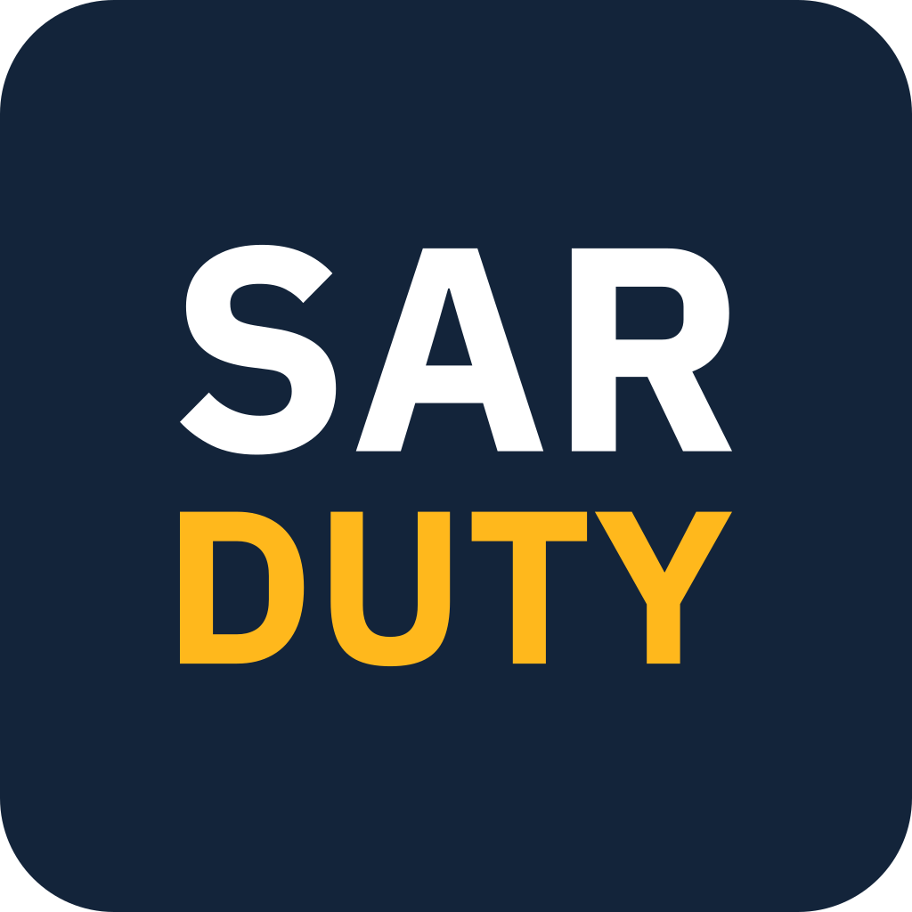

#  SAR Duty

Less paperwork for search and rescue teams.

SAR Duty builds on a team's D4H records with tools made for volunteer teams. It runs at
[sarduty.com](https://sarduty.com).

- **Tax credit letters** from the hours each member gave, emailed to them. Anyone can
  verify a letter online.
- **ID cards** on members' phones, in Apple Wallet or Google Wallet, with a QR code to
  verify.
- **Attendance at the door**: scan members in and out on a phone or an iPad.
- **Reports and charts**: ask a question of the team's records, such as who gave the most
  rope hours, and draw the answer as columns, lines, bars, a calendar, or a map. An AI
  agent can write the query without ever seeing a member or a record.
- **Everything a team admin keeps track of**: activities and replies, members, groups,
  qualifications, equipment, chores, and travel.


## Setup

```sh
brew install mise flyctl mupdf  # mupdf's mutool reads a form's page
cp .mise.example.toml .mise.local.toml
# All optional in dev; tests need none
mise trust
mise install
mix setup
```

Then `mise run server` and open <https://sd.dev.gshaw.ca>. Caddy on Gerry's Mac serves
that name and forwards it to 4025, which listens on 127.0.0.1 only.

## Tasks

- `mise run server` starts the dev server; `iex -S mix phx.server` starts it inside IEx.
  `tools/dev-server.sh` serves a worktree the same way, on the main checkout's database.
- `mix run --no-start tools/dev-teams.exs` adds the dev teams on a local SAR Duty Records:
  Coast Range SAR (`coastrange`), with a site admin as a team admin, Silver Basin SAR
  (`silverbasin`), and their organization, WESARA (`wesara`). Try a branch on them
  without touching a real team's data. `--reset` builds them again with today's dates,
  and `--photo <file>` sets your photo. It needs `RECORDS_HOST` and `RECORDS_SARDUTY_KEY`
  ([records.md](docs/records.md#records-in-dev)).
- `mise run check` formats, lints, spell-checks, and compiles. `mise run lint` checks
  without changing anything.
- `mise run test` runs the tests; `mise run ci` runs checks and tests. Run it before
  pushing.
- Every commit runs the pre-commit hook in [hk.pkl](hk.pkl): Markdown and spelling
  through [stet](https://github.com/gshaw/stet), then `mix format --check-formatted` and
  Credo, on the staged files only. It checks and never changes files. It needs hk's
  global hook, once per Mac: `hk install --global --mise`.
- `mise run deploy` deploys `origin/main` — see [docs/deployment.md](docs/deployment.md).

How the app is built: [docs/README.md](docs/README.md). Working in this repo as an agent:
[AGENTS.md](AGENTS.md).

## License and name

The code is MIT licensed: use it, change it, run your own copy. The name is not part of
the license. Please don't use "SAR Duty" or its logo in the name of your own app, fork,
or service, so people don't mistake it for this one. "Works with SAR Duty" is fine.
