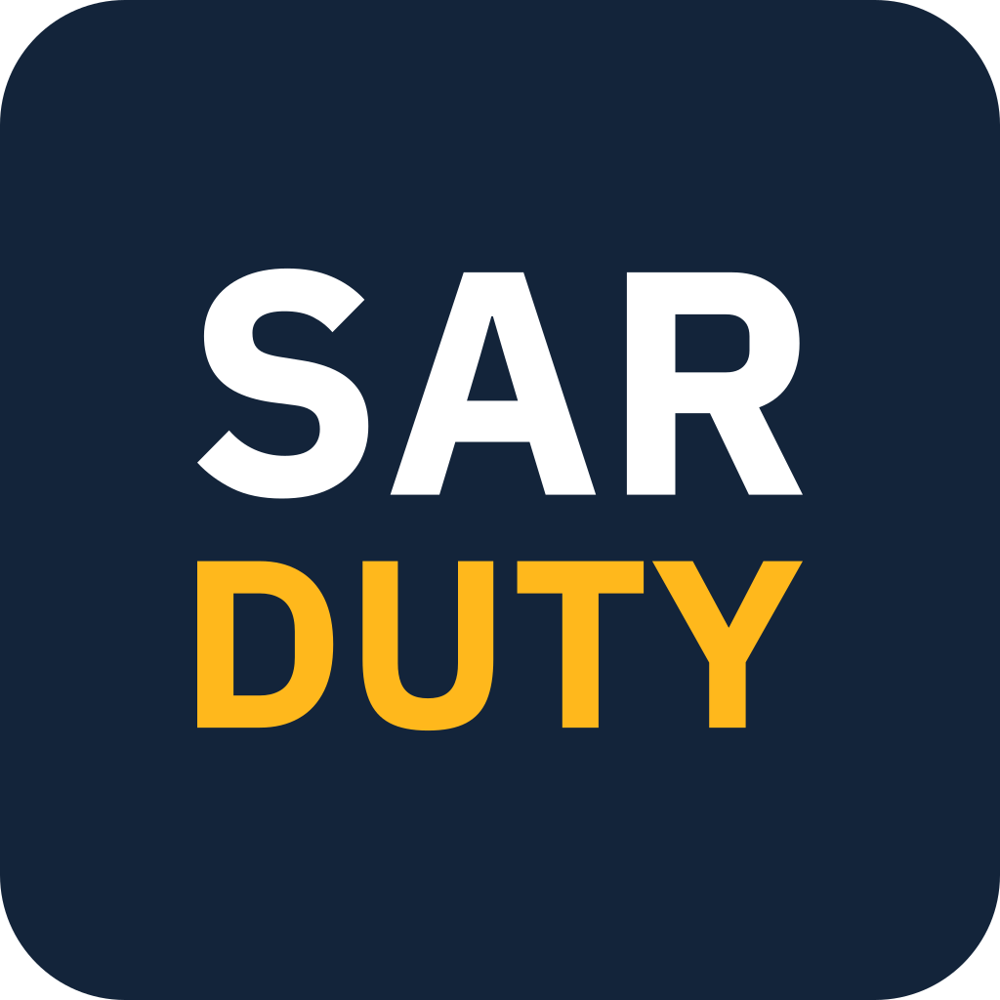

#  SAR Duty

Less paperwork for search and rescue teams.

SAR Duty builds on a team's D4H records with tools made for volunteer teams. It runs at
[sarduty.com](https://sarduty.com).

- **Tax credit letters** from the hours each member gave, emailed to them. Anyone can
  verify a letter online.
- **ID cards** on members' phones, in Apple Wallet or Google Wallet, with a QR code to
  verify.
- **Attendance at the door**: scan members in and out on a phone or an iPad.
- **Everything a team admin keeps track of**: activities and replies, members, groups,
  qualifications, equipment, chores, travel, and reports.


## Setup

```sh
brew install mise flyctl puma-dev
puma-dev -install
cp .mise.example.toml .mise.local.toml
# Add MAPBOX_ACCESS_TOKEN; the rest are optional in dev
mise trust
mise install
mix setup
git config core.hooksPath bin/git-hooks
echo 4025 > ~/.puma-dev/sarduty
```

Then `mise run server` and open <https://sarduty.test>.

## Tasks

- `mise run server` starts the dev server; `iex -S mix phx.server` starts it inside IEx.
  `tools/dev-server.sh` serves a worktree the same way, on the main checkout's database.
- `mix run --no-start tools/dev-sar.exs` adds Dev SAR, the made-up Coast Range cast with
  the site admins as team admins, to try a branch on without touching a real team's data.
  `--reset` seeds it again with today's dates.
- `mise run check` formats, compiles, lints, and spell-checks.
- `mise run test` runs the tests; `mise run ci` runs checks and tests. Run it before
  pushing.
- `git push` first runs CI's static checks, all but the compile, through
  `bin/git-hooks/pre-push`, once `core.hooksPath` is set as in Setup.
  `git push --no-verify` skips them.
- `mise run deploy` deploys `origin/main` — see [docs/deployment.md](docs/deployment.md).

How the app is built: [docs/README.md](docs/README.md). Working in this repo as an agent:
[AGENTS.md](AGENTS.md).

## License and name

The code is MIT licensed: use it, change it, run your own copy. The name is not part of
the license. Please don't use "SAR Duty" or its logo in the name of your own app, fork,
or service, so people don't mistake it for this one. "Works with SAR Duty" is fine.
